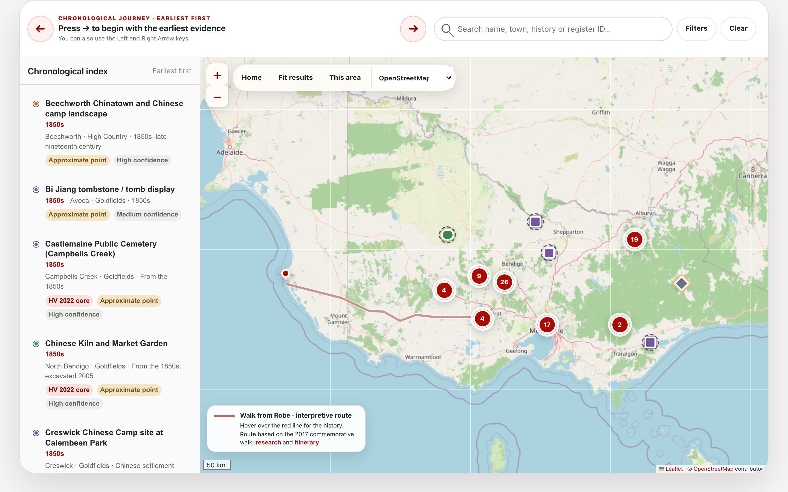

# Victorian Chinese Heritage Map

*A Living History, Mapped Across Victoria*  
**Concept-stage project proposal**

**Prepared for:** Chinese Community Council of Australia (Victoria) — CCCAV  
**Funding requested:** **AUD $4,000**  
**Proposed delivery period:** Three months from approval  
**Prepared:** 3 August 2026  
**Project stage:** Concept definition, experience design, demonstration website and feasibility planning

---

## 1. Proposal summary

CCCAV seeks **AUD $4,000** to develop the concept for a *Victorian Chinese Heritage Map*: a future digital resource that would make the long, diverse history of Chinese people in Victoria visible through place.

This is a **concept-stage project**. The requested funding is for defining what the resource should be, who it should serve, how its content and interface could work, and what would be required to develop and sustain it responsibly. It also includes a limited demonstration website that will make the concept tangible for CCCAV, community representatives, partners and potential funders. The demo will not be a complete or publicly launched service.

The concept will be informed by an existing body of exploratory research covering **86 potential heritage findings across Victoria**. This material demonstrates the opportunity and provides realistic examples for design, but it will be treated as a research foundation—not as a completed inventory, approved dataset or public-ready product.

The investment will support:

- discovery, audience and content definition — approximately **$1,000**;
- concept design, user experience and demonstration website — approximately **$2,000**; and
- technical feasibility, safeguards and next-stage planning — approximately **$1,000**.

At the end of three months, CCCAV will have a clear, evidence-informed concept package and a working demonstration website with which to consult community representatives and partners, communicate the opportunity, seek development funding and decide whether and how to proceed.

## 2. The concept

The proposed *Victorian Chinese Heritage Map* would be an interactive, evidence-led digital experience connecting places across metropolitan and regional Victoria to histories of migration, mining, work, worship, burial, enterprise, family, community organisation, resistance and commemoration.

The goal of this stage is to define that experience and demonstrate its core idea through a small, working website. Using a representative selection of research content, the demo will show how visitors might move between the historical overview, map or list, filters and individual place records. It will provide a concrete basis for discussion and review without implying that the full resource is ready for publication.

Its central interpretive idea is:

> Chinese Victorian history is a living history of work, family, worship, resistance, enterprise and belonging—not only a story of the gold rush.

The concept study will explore how a future resource could enable people to:

- discover heritage places through an accessible statewide map and non-map list;
- browse by historical period, region and theme;
- search for places and, in a later stage, people associated with them;
- understand why each place matters and what evidence supports its inclusion;
- distinguish registered places, verified records, documentary leads and approximate locations;
- follow plain-language interpretation back to authoritative sources; and
- engage respectfully with graves, archaeological sites, private land and culturally sensitive places.

Possible content types include cemeteries and funerary heritage, temples and churches, association buildings, mining and archaeological landscapes, market gardens, shops, cafés, industrial sites, museums, memorials and urban precincts. These possibilities will be tested and prioritised during the concept stage rather than assumed to be final.

## 3. Research foundation and opportunity

Exploratory work already undertaken provides a strong basis for concept development.

| Exploratory research measure | Current position |
|---|---:|
| Potential heritage findings assembled | **86** |
| Findings with documentary verification | **79** |
| Documentary-only findings | **1** |
| Findings requiring field verification | **6** |
| Distinct source links recorded | **267** |
| Findings with registered photographs | **41** |

These figures are working research measures. They do not imply that the proposed scope has been endorsed, that the inventory is exhaustive, that every place has been inspected, or that all text and images are cleared for publication.

Exploratory interface studies have also tested ways of combining a map, chronological index, evidence filters and place details. During this project, they will be used as discussion material and as a starting point for the limited demonstration website; neither the studies nor the demo will be presented as a completed public product.

## 4. Why this project matters

Chinese people have been part of Victoria since before the gold rush and have made enduring contributions to the state's economic, cultural, social and civic life. Yet this history is still too often reduced to nineteenth-century mining or presented as disconnected local episodes.

Heritage places offer a richer way into this story. Cemeteries and funerary burners record migration, death, ritual and community care. Temples, churches and association buildings show worship and organisation. Market gardens, sawmills, shops, cafés and mining landscapes demonstrate work, skill and enterprise. Museums, memorials and restored sites reveal how later generations have protected and interpreted this inheritance.

A well-defined place-based digital concept could:

1. **Make an under-recognised history visible** by connecting metropolitan and regional experience within a statewide frame.
2. **Broaden the public narrative** beyond gold mining to family, religion, business, political organisation, resistance and belonging.
3. **Connect past and present** by placing historic heritage within the story of a large, diverse and living community.
4. **Support education and research** through an accessible pathway to evidence and custodial sources.
5. **Encourage stewardship** through careful treatment of uncertainty, access and culturally sensitive places.
6. **Create a pathway from places to people** through future research into names, biographies, family histories and burial records.

## 5. The public-domain gap

Important resources already exist, including the Victorian Heritage Database, Heritage Victoria publications, cemetery registers, council heritage studies, museum collections, local histories, archives and specialist projects such as *Scattered Legacy*. Their work is essential, but information is distributed across systems created for different purposes.

A member of the public often needs to know which register, institution, cemetery trust, council or local-history website to search. It can be difficult to:

- discover Chinese heritage places across Victoria from one starting point;
- see relationships between dispersed places, periods and activities;
- search geographically and chronologically;
- distinguish protected places from documentary leads or approximate locations;
- trace a plain-language account back to its evidence;
- find regional and non-mining histories alongside familiar goldfields and Chinatown narratives; or
- connect places with the people who lived, worked, worshipped or were buried there.

The concept stage will examine how a future CCCAV resource could connect—not replace—authoritative registers, collections and local knowledge. It will also identify where consultation, permission, specialist advice or additional research would be needed before development.

## 6. Purpose and scope of the requested funding

### A. Discovery, audience and content definition — approximately $1,000

- confirm the concept's purpose, priority audiences and intended public benefit with CCCAV;
- identify representative user needs and core journeys;
- review the exploratory research and select examples suitable for concept development;
- define a preliminary content structure, inclusion principles and evidence-status model; and
- identify key stakeholders, custodians and consultation needs for a later stage.

### B. Concept, user-experience design and demonstration website — approximately $2,000

- develop the proposed information architecture and navigation model;
- prepare low- or mid-fidelity concepts for the landing page, map/list explorer and place detail;
- illustrate possible search, filter, timeline and responsible-access interactions;
- define an initial visual direction appropriate to CCCAV and the subject matter;
- build a limited static demonstration website using representative content and selected core interactions;
- consider mobile use, keyboard access, non-map discovery and plain-language presentation from the outset;
- label the demonstration clearly as concept material not intended for general publication; and
- review the concept and demo with CCCAV and refine them in response.

### C. Feasibility, safeguards and next-stage planning — approximately $1,000

- assess suitable high-level technical approaches, hosting assumptions and maintainability;
- identify content, copyright, privacy, cultural-sensitivity and location-disclosure risks;
- define what must be verified, cleared or consulted on before publication;
- outline development phases, roles, dependencies and indicative future costs; and
- prepare a concise brief that can support fundraising or procurement for the next stage.

## 7. Concept-stage deliverables

Within three months of commencement, the project will deliver:

1. a concise concept brief defining purpose, audiences, principles, scope and public value;
2. an audience-needs and core-user-journeys summary;
3. a proposed information architecture and preliminary content/data model;
4. annotated concept designs for key screens and interactions, covering desktop and mobile considerations;
5. a limited working demonstration website showing the core concept with a representative selection of places and content;
6. a recommended approach to evidence labels, sensitive locations, access advice, source attribution and image rights;
7. a high-level technical feasibility note covering platform options, accessibility, hosting and maintenance assumptions;
8. a prioritised roadmap distinguishing a minimum viable first development stage from later enhancements; and
9. a next-stage brief with indicative resourcing, dependencies, risks and cost ranges.

The demonstration website is a concept-communication and review tool. A production-ready website, complete dataset, comprehensive rights clearance, production hosting, ongoing maintenance and public launch are not included in these deliverables.

### Acceptance criteria

The concept stage will be complete when:

- CCCAV has reviewed and approved the concept's purpose, primary audiences and proposed scope;
- the main user journeys can be understood from the annotated designs and demonstrated through the limited website;
- the demo enables a reviewer to open the overview, explore representative places through a map or list, use selected filters and view a sample place record;
- the demo is clearly identified as concept-stage material and does not imply that sample content is complete or publication-approved;
- the proposed content model shows how place, time, theme, evidence, sources, access and sensitivity could be represented;
- accessibility, cultural sensitivity, copyright and location-disclosure requirements are recorded as design constraints;
- assumptions and unresolved questions are clearly identified; and
- the roadmap gives CCCAV a practical basis for a development-stage funding or procurement decision.

## 8. Work plan

| Period | Activity |
|---|---|
| Month 1 | Project initiation; confirm purpose, audiences, decision-makers and consultation boundaries; review exploratory research; define user needs, content principles and representative scenarios |
| Month 2 | Develop the information architecture, key user journeys and annotated interface concepts; build the limited demonstration website with representative content and interactions |
| Month 3 | Conduct the CCCAV concept and demo review; refine the direction; assess feasibility, safeguards and dependencies; finalise the demo, concept package, roadmap and handover |

## 9. Budget

| Cost item | Amount (AUD) |
|---|---:|
| Discovery, audience and content definition | $1,000 |
| Concept design, user experience and demonstration website | $2,000 |
| Technical feasibility, safeguards and next-stage planning | $1,000 |
| **Total project cost / funding requested** | **$4,000** |

The budget is a fixed concept-stage envelope. Allocation between sub-items may vary slightly by agreement while the total remains **AUD $4,000**. GST treatment, if applicable, will be confirmed before engagement.

### Value for money

The project draws on substantial exploratory research and interface studies, allowing the funding to focus on concept clarity, informed design decisions and a credible path to delivery. The demonstration website will give CCCAV and potential partners something concrete to review, while resolving purpose, scope, safeguards and technical assumptions before production development. This will support better-costed funding applications and reduce avoidable rework in a later stage.

## 10. Scope boundaries

This stage does not include:

- production development, public hosting or launch of a complete website;
- full implementation of all 86 research findings or every proposed feature;
- formal usability research beyond the focused CCCAV review of the demonstration;
- comprehensive verification or field inspection of all potential places;
- full transcription of cemetery or archival records;
- final editorial, legal, cultural or curatorial approval of content;
- permission clearance for all third-party photographs and source material;
- a complete people database, oral-history collection or community-submission system;
- full translation, a professional WCAG 2.2 AA audit or a security assessment; or
- ongoing research, consultation, maintenance or content governance.

The concept package will identify which of these activities are prerequisites for development and which could be undertaken in later phases.

## 11. Principles and safeguards

| Principle or risk | Concept-stage response |
|---|---|
| Research may be mistaken for a complete or statutory record | Define visible disclaimers, evidence categories, review dates and links to authoritative sources |
| Sensitive places may be exposed | Establish criteria for generalising or withholding locations and for consulting relevant custodians |
| Errors or contested interpretations may arise | Propose transparent sourcing, uncertainty labels, review responsibilities and a future correction pathway |
| Image and content rights may be unclear | Specify a rights register and a clearance workflow for any later publication stage |
| The experience may exclude non-map or assistive-technology users | Include list-based discovery, semantic structure, keyboard use and accessible content in the design requirements |
| The concept may exceed likely future resources | Separate essential first-stage capabilities from later enhancements and state key cost drivers |
| The resource may become outdated | Define governance, review, maintenance and data-export needs for later planning |

The proposed resource would be an interpretation and discovery tool, not a statutory register, heritage certificate, cadastral map or record of physical inspection. A public map point would never constitute permission to enter land.

## 12. Development pathway beyond this proposal

Subject to the concept-stage findings and future funding, later phases could include:

### Phase 2 — Validation and detailed design

Consult priority audiences, community representatives and custodians; evaluate the demonstration website; validate representative records; resolve rights issues; refine content standards; and develop testable detailed designs.

### Phase 3 — Build and controlled content preparation

Develop an accessible website and content-management workflow; prepare and review an agreed first-release dataset; conduct technical, usability and cultural-sensitivity testing; and establish hosting and governance arrangements.

### Phase 4 — Publication and growth

Launch an approved public resource, monitor use, maintain content and progressively consider:

- a searchable people and names index;
- moderated community corrections and contributions;
- bilingual or multilingual access;
- oral histories and family collections;
- education resources and thematic trails;
- expanded research and field verification; and
- partnerships with custodians, councils, museums, historical societies and universities.

Progression between phases would depend on CCCAV approval, consultation outcomes, verified content, permissions and appropriate funding.

## 13. Expected outcome and public benefit

The immediate outcome will be a well-defined and reviewable concept supported by a limited demonstration website—not a public-ready service. Together, these will give CCCAV:

- a shared vision for the proposed resource;
- evidence that the idea is grounded in substantive research;
- a tangible, working way to demonstrate and discuss the proposed experience with community members, partners and funders;
- early identification of ethical, cultural, legal and technical requirements; and
- a realistic roadmap for deciding whether to invest in development.

If subsequently developed, the resource could provide community members and descendants with recognition of a long and diverse presence; give students and educators an accessible place-based research starting point; help regional communities and visitors understand local places within a statewide story; and connect users back to authoritative sources and custodians.

Most importantly, the concept creates a pathway for heritage places to be connected with people. Future work on names, biographies and family stories could ensure that Chinese heritage in Victoria is understood not only as buildings, ruins and map points, but as the lives and contributions of individuals and communities across generations.

## 14. Recommendation

That CCCAV approve **AUD $4,000** for a three-month concept-definition, experience-design, demonstration-website and feasibility-planning stage for the *Victorian Chinese Heritage Map*, subject to confirmation of GST treatment and the nominated CCCAV review process.

This investment will give CCCAV a clear, responsible and fundable basis for deciding on a future development stage, without prematurely committing to a particular platform, feature set or public launch.

---

**Project credit:** Concept and exploratory research by Dr Jian Chen and the Chinese Community Council of Australia (Victoria).  
**Organisation website:** [www.cccav.org.au](https://www.cccav.org.au)
